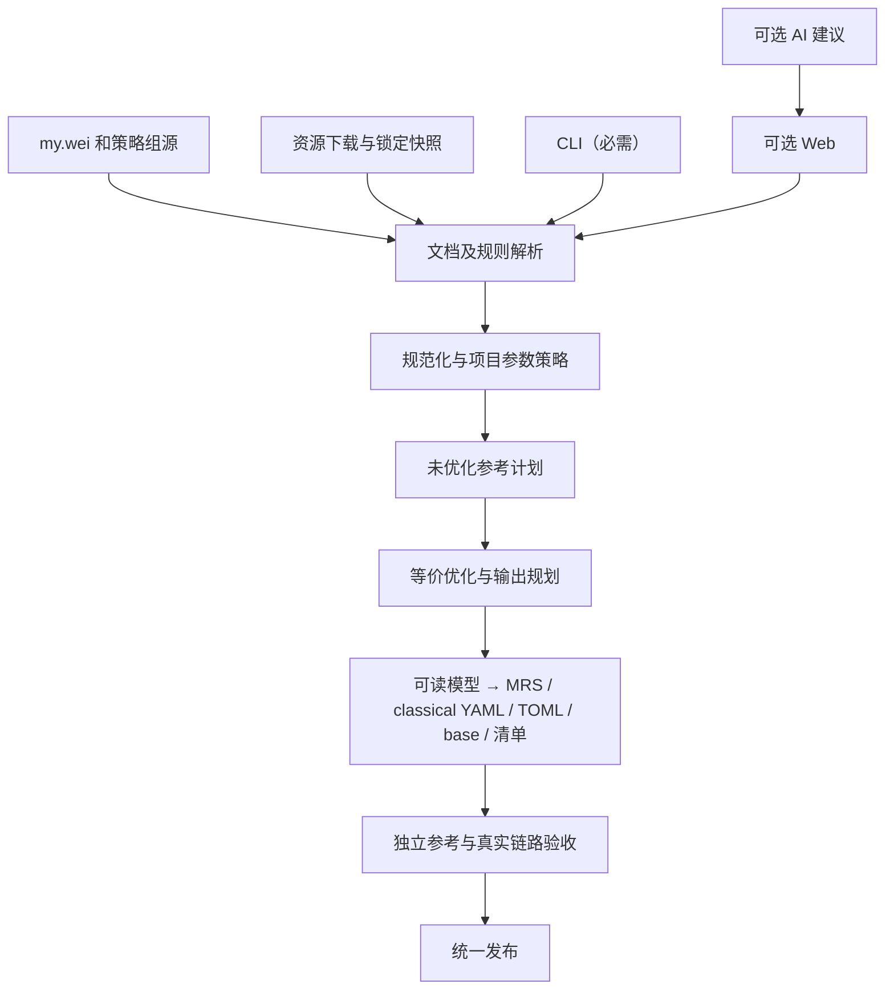

# DomainRouter v2 实施规范 · 核心架构、算法与排序

版本：1.5 · 日期：2026-11-08 · 第 7～10 节

本分册与入口索引列出的其他三份分册共同构成完整规范，必须顺序阅读；本文件不是单独的需求摘要。

[返回规范入口](../v2-implementation-spec.md)

## 7. 核心架构与数据模型

### 7.1 实施默认技术

核心使用 Python 独立包，最低 Python 3.13，`pyproject.toml` 管理项目、uv 锁定依赖。CI 固定经过验证的解释器和依赖版本，不使用仓库现有 `script/env` 作为交付环境。构建 MRS 需要固定的 Mihomo 编译器二进制；它是显式构建工具依赖，不是需要启动的常驻服务。纯解析/check 可在没有该工具时工作，正式 MRS build 不得悄悄降级为 YAML。

使用可安装的 src 布局，默认 build backend 为固定兼容版本的 `uv_build`，显式配置 `domainrouter_v2 = "domainrouter_v2.cli:main"` console script。README 从干净克隆的 `uv sync --locked`、`uv run --locked domainrouter_v2 ...` 开始，不依赖预先激活虚拟环境。提交 uv.lock；`--locked` 校验锁与工程一致，不能把跳过一致性校验的 `--frozen` 当同义替代。CI 同时测试最低支持的 3.13 和选定的新版本；只声明实际测过的平台/解释器。包构建产物输出到 `build/packages/`，避免 `uv build` 默认 dist 与规则 dist 混用。

规则模型优先使用 dataclass、Enum、类型注解和 Protocol。YAML 使用安全解析/序列化库；TOML 使用标准库读取和经过锁定的序列化库写出，禁止手工拼接带转义的值。测试使用 pytest 和属性测试工具；复杂正则由目标内核验证，不通过 Python re 冒充。

Python 依赖安装与核心执行的网络边界分开：uv sync/tools prepare 可以显式联网，准备好的环境才承诺离线 build。严格离线演示使用该环境内的 CLI 或 `uv run --offline --locked ...`，避免 uv 自动补装依赖造成“规则构建不联网”的表述失真；缺失依赖时应失败，不能回退旧虚拟环境。

不要为了“现代化”引入核心不需要的数据库、消息队列或微服务。性能确有证据不足时再优化热点，不预先引入多语言运行时；测试适配器使用 Go 或真实内核进程不改变 Python 核心的独立性。

### 7.2 模块职责

| 模块 | 职责 | 不应承担 |
| --- | --- | --- |
| document/lexer | 原文、节、引号、位置和粘贴块 | 下载、优化 |
| parsers/adapters | 自由行及来源格式解析 | 路由建议、写输出 |
| sources | 下载、内容存储、锁文件 | 解释规则含义 |
| normalize | 类型化、域名/IP 规范化、项目参数策略 | 改变业务优先级 |
| optimize | 证明并执行等价化简 | 直接联网、跨合集删规则 |
| planner | 分区、排序、引用顺序、后端选择 | 掩盖不支持的语义 |
| emitters | YAML/TOML 与清单序列化 | 再次猜测输入类型 |
| mrs | 调用固定 Mihomo 编译器、验证二进制和可读模型一致 | 自行实现二进制协议、替代规则优化 |
| converter_bridge | 根据输出计划生成 provider 格式覆盖和完整 base | 改写 DNS、组和路由意图 |
| explain/analyze | 命中解释、覆盖与冲突报告 | 自动改写用户意图 |
| verify | 参考解释器、转换与内核验证 | 发布不完整结果 |
| cli | 参数、退出码、调用同一引擎 | 重复实现算法 |
| web/ai | 可选编辑和建议 | 绕过核心语义 |

建议处理管线：`parse → resolve sources → normalize → apply project policy → create reference plan → optimize → plan → emit readable → compile MRS → bridge config → verify`。发布独立于构建。

### 7.3 必备模型

| 模型 | 最低字段/作用 |
| --- | --- |
| SourceSpan | 文件/资源、行列、原始范围、输入上下文 |
| Document | 原文、节、注释、规则节点、引用节点 |
| Collection | 原名、稳定 artifact ID、有序成员、是否允许为空 |
| Rule | 类型、结构化 payload、参数、效果类别、全部来源 |
| DomainPattern | 标签序列、精确/通配约束、允许的额外前缀层级 |
| IPCondition | 地址族、网络、source/destination、有效参数 |
| CompoundRule | 运算符及有序子节点，禁止用逗号字符串代替树 |
| RouteEntry | 原始序号、合集引用或内联条件、目标和参数 |
| SourceSnapshot | 请求标识、内容哈希、格式、状态与锁定信息 |
| OptimizationEvent | 规则 ID、变换类型、覆盖者/合并成员、证明类别 |
| OutputPlan | 每合集分区、顺序、文件名、引用、参数、后端 |
| Artifact | behavior、format、内容哈希、编译器标识、发布/调试角色 |
| ProviderBinding | route 序号、资源 ID、fork 实际 provider 名、格式、引用参数 |
| Diagnostic | 稳定代码、级别、位置、原因和可执行的修正提示 |

规则 ID 由版本化的规范表示计算。语义去重键包含规范化后的类型、payload、匹配方向、有效参数及必要的外部数据版本；不包含来源、原文引号或行号。不同输入写法只有先转换到同一语义类型才比较。合集不同不能因此共享删除决策；相同键只是候选，不自动证明跨求值位置删除安全。

副作用/能力至少区分：纯域名、已有元数据、进程查询、目标 IP 解析、外部地理数据、路由控制。效果类别用于限制排序，不等于运行时精确成本估计。

规范化策略变化必须提高语义版本并使构建哈希变化。对同一输入生成两次不同含义而仍复用同一版本标识是不允许的。

## 8. 规范化与项目参数策略

按以下顺序执行，每一步都保留来源并产生必要的事件：

1. 按上下文去除明确外包装，保留单引号标记。
2. 识别显式规则、指令、IP、CIDR 和域名模式。
3. 解析字段及表达式树，区分原出口和参数。
4. 规范化类型、域名、地址和可以证明等价的字段表示。规则类型 token 按 ASCII 大写后精确查注册表，与目标解析器的类型大小写习惯一致；payload、目标组和参数不随之全局改大小写。
5. 自由域名行应用用户确认的子域名扩展；结构化/第三方输入不应用这一扩展。
6. 应用项目目标 IP `no-resolve` 策略。
7. 检查目标内核、适配器和输出后端是否可以表达。
8. 建立未优化的参考输出计划，再执行化简和可验证排序。

### 8.1 域名模式的统一表示

对原生标签模式，用“固定标签序列 + 允许的额外前缀层级”表示。标签为 literal 或匹配一个完整非空标签的 ANY；额外前缀层级为一个确定值或有下限、无上限的区间。首版不合成无法用单个原生模式表达的有限多值层级区间。

例如：

| 模式 | 固定部分 | 额外前缀层级 |
| --- | --- | --- |
| 精确 `a.hk` | `a.hk` | 0 |
| `*.a.hk` | `a.hk` | 恰好 1 |
| `+.a.hk` | `a.hk` | 0 到无限 |
| `.a.hk` | `a.hk` | 1 到无限 |
| 精确模式 `xbox.*.example.com` | `xbox.ANY.example.com` | 0 |

自由行的隐式扩展对匹配结果增加任意层级前缀。例如未加引号 `*.a.hk` 的“恰好 1”变为“至少 1”，并不变成包含 `a.hk` 自身。模式内部的 ANY 仍保留位置约束。

这一模型用于包含证明；输出还必须遵守目标原生语法。不要把无限层级通配简单实现为跨点的字符串 `.*`。

用于规范键和证明的等价表示为 `(min_labels, max_labels, literals_from_right)`：

- 层级按完整非空标签计数，max_labels 可以为正无穷；literal 位置从右端 0 开始。
- `a.hk`：长度 `[2,2]`，literal 为 `{0: hk, 1: a}`；`*.a.hk`：`[3,3]`，同一 literal 表；`.a.hk`：`[3,∞]`；`+.a.hk`：`[2,∞]`。
- `xbox.*.example.com`：`[4,4]`，literal 为 `{0: com, 1: example, 3: xbox}`；前面加 `+.` 只把长度上界改为 ∞。
- 删除固定部分左端的 ANY 时，必须把相应层数计入长度下限；不能丢失最少层数。连续多个 ANY 也如此。
- 这个键唯一表达本节的单模式语言，包含判断不依赖输入拼写或原文顺序。恢复原生表示时，确定层数使用相应数量的 `*`，无上界使用 `+.`/前导点及必要的 `*`；全通配没有 literal 时也必须产生合法非空模式，如 `*`、`*.*`、`+.*`、`.*`。不能输出孤立的 `.` 或 `+`。

证明模型的论域是目标 reader 可接受的非空标签串；它不是 DNS 存在性查询，也不按一个测试样本代表全部其他标签。原生模式语法及匹配边界要经过目标版本验证。DOMAIN-WILDCARD、正则、逻辑表达式不进入本节模型。

域名规范化另有上下文契约：手写自由域名、手写 DOMAIN/DOMAIN-SUFFIX 的字面域名字段和 `@site` 的 Unicode literal 标签，默认经固定版本的 idna 库执行 UTS #46 非过渡映射与 IDNA2008 A-label 转换，记录变换；先识别原生分隔符/通配，再逐 literal 标签处理，禁止让 Unicode 映射引入未重新校验的额外层级或通配。已有 ASCII 原生标签按目标校验并做 ASCII 小写，不用 Python casefold 扩大等价类；下划线等内核允许的非 IDNA ASCII 标签不能误送入 IDNA 后删符号修复。

显式第三方条件和 domain provider 默认保留来源的 literal 语义，不把 Unicode 字面量或 FQDN 末尾点自动改成另一个匹配集合。需要修复时先报告具体差异，由显式导入规范化策略确认；首版没有该策略时拒绝该项并建议提供规范 A-label 输入，不能静默改变来源。手写 FQDN 去一个末尾根点属于已记录的 authoring 修复，仍须重新校验。关键词、正则、字符通配的 payload 不做 IDNA 转换。D12 必须分别测试这些上下文，而非只测一个 Unicode 域名样例。

### 8.2 no-resolve 的准确处理

首版默认 profile 对所有目标 IP 匹配条件启用不主动解析策略，包括目标 CIDR、目标 GEOIP、目标 IP-ASN、目标 IP-SUFFIX，以及逻辑表达式中的对应叶节点。

- `no-resolve` 是跳过该匹配条件主动发起目标解析，不是禁止使用已有真实 IP，也不是对整个 DNS 配置的安全保证。
- 原生 ipcidr provider 的参数由 `RULE-SET` 引用承载；用户 fork 已有追加逻辑，最终验证必须确认参数只有一份且位置正确。
- classical 的简单目标 IP 条件在相应规则上携带参数。不能给整个混合 classical 的 RULE-SET 统一加 no-resolve 来替代叶节点处理；那会同时影响集合内其他条件的 helper。
- AND/OR/NOT 中的目标 IP 条件递归处理相应叶节点；不能在逻辑表达式末尾随意拼接参数，不能依靠父逻辑类型忽略的参数。
- 来源 IP 条件按注册类型处理，不能因为名字含 IP 就当目标 IP 条件。
- 内联目标 IP 规则也应用此策略；复杂内联表达式必须经过 fork 的真实链路验证，不能假设和原生 classical 引用一样。
- 外部规则原始参数和项目覆盖策略分别记录。正确性比较基线是在项目策略应用之后。
- 需要主动解析的其他 profile 不属于首版默认承诺。当前 fork 强制为原生 ipcidr 引用补参数；不能宣称一个配置开关就能绕过这一行为。
- 首版 `target_ip_no_resolve` 必须为 true；false 或未知“resolve”参数在配置校验时拒绝，不生成看似可用却与 fork 不一致的 profile。
- 未知目标 IP 与“已知但不在网段中”是不同元数据状态。叶节点在 no-resolve 且 IP 未知时的结果由目标内核决定；例如 `NOT(IP-CIDR,...)` 可能因叶节点不匹配而匹配，不能为了直觉上的结果在优化时删除 NOT 或补一次 DNS。
- MRS 只编码域名/地址集合，不编码出口、source/destination 选择或 no-resolve。参数继续属于正确的引用/条件位置，不能期待编译到 MRS 后自动附带。

## 9. 去重与合并算法

### 9.1 通用前提

每次化简都要满足：同一合集、相同匹配对象和有效参数、变换在目标语义下等价。纯规则集合的基本要求为：

`match_set(normalized_input) = match_set(optimized_output)`。

路由及有运行行为的条件还必须满足第 13 节的全链路要求。集合相等不是带副作用规则任意重排的充分条件。

domain 与纯 no-resolve 目标 CIDR 分区可以按语义键全局去重。classical 仅在第 10.3 节定义的无副作用连续区段中稳定去重；带效果/复合条件首版只保留原顺序和成员，不因语义键相同跨区段删除。不得同时互删两条等价规则而丢失全部代表。

例如一个 no-resolve IP 条件在真实 IP 未知时失败，随后若执行了一个会填充 IP 的效果条件，同一个 IP 条件可能在后面成功。即使首版已禁止主动目标解析，也必须保留这类通用安全边界，防止未来效果或配置扩展破坏正确性。相同字符串不是跨求值位置去重的充分条件。

### 9.2 普通域名与后缀

使用反向标签 trie，按 `hk → a → www` 的方向组织。节点分别表达自身终止、任意下级终止和单标签通配分支，不能用一个布尔值混淆精确与后缀。

必须实现：

- 已有 `+.a.hk` 时，删除同范围内精确域名、子后缀和原生通配子模式。
- 已有 `.a.hk` 时，删除其下级条目，保留精确 `a.hk`。
- 精确 `a.hk` 与 `.a.hk` 合并成 `+.a.hk`。
- 精确父域名不覆盖子域名。
- 按完整标签判断范围，不能让 `a.hk` 覆盖 `not-a.hk`。
- 同一有限组子域名不推断为通配规则；即便看起来全部属于同一服务，也不能扩大范围。

主路径成本应随输入标签总量增长；允许为稳定排序增加排序成本。禁止对十万级普通域名默认执行全量两两比较。

### 9.3 原生通配模式包含

本节原生语言不需要通用自动机。令 `Len(P)` 为第 8.1 节的总标签数区间、`Lit(P)` 为右端位置到 literal 的约束表。在该非空标签语言上，`L(P) ⊆ L(Q)` 当且仅当：

1. `Len(P) ⊆ Len(Q)`；
2. 对 `Lit(Q)` 的每个 `(位置, literal)`，`Lit(P)` 在同一位置也有完全相同的 literal。

理由：第一项保证 Q 接受 P 的所有层数；第二项保证 Q 的每个固定标签都被 P 强制满足。若长度不包含，取差集中任一层数即可反例；若 Q 的 literal 未被 P 约束，选一个不同的合法非空标签即可反例。这里是本项目根据原生语法推导的算法，不是声称内核提供了包含 API。边界合法性按第 8.1 节处理；必要性见证不能使用目标不接受的空标签或非法字节。

具体反例：`*.a.hk` 不覆盖 `a.b.a.hk`，因为前者只接受 3 层；`.a.hk` 不覆盖精确 `a.hk`，因为最少为 3 层；`a.*.hk` 不覆盖 `b.a.hk`，因为右端位置 2 的 literal 不同。未加引号 `*.a.hk` 在解析时已成为 `.a.hk`，所以可以删除 `a.b.a.hk`。不能让优化器再次猜测是否隐式扩展。

实施步骤：

1. 先按规范键精确去重。常规精确/后缀走反向 trie；含 ANY 的模式用反向约束 trie、固定后缀和层级索引筛候选。
2. 对所有可能覆盖关系执行上述精确判断；单对成本与标签/约束数量有关。候选索引必须是完备的，只能少比较不可能的项，不能漏掉中间/多处 ANY、全通配或额外前缀之间的包含关系。
3. 仅在覆盖者仍为活动代表时提交删除。按规范键的固定次序选择等价代表；不批量互删。证明缓存包含语义版本，覆盖事件最终归约到仍存在的代表。
4. 必须合并同一原生模式 P 的“自身模式 + 其全部真子域闭包”，例如 `xbox.*.example.com` 与 `.xbox.*.example.com` 合成 `+.xbox.*.example.com`。可按相同 literal 表的长度区间精确并集实现；只有并集能表达成一个原生模式时才合成，不能填补缺失层级，也不能把有限子域列举推成 ANY。
5. 合并后重新检查包含，直到固定点。最终 domain 分区不能残留任一被另一条完整包含的模式。该原生判断没有“证明状态超限后跳过”的路径；全任务超时/资源不足使构建失败，不发布半优化结果。

普通域名/后缀必须使用第 9.2 节的高效主路径；不能以证明简单为由全量两两比较。复杂通配在病态输入下可能有大量候选，应记录候选数、峰值和耗时，不承诺任意模式集都线性。首版不要求求出多个不同模式联合覆盖的全局最小表示；只做上述明确合并与成对包含。任意正则、跨类型或可选联合分析的资源限制不得削弱本节必需保证；可选分析超限保留规则并报告 `W_OPTIMIZATION_LIMIT`。

### 9.4 CIDR 精确集合合并

按地址族、方向和有效参数分桶，然后：

1. 将每个网络表示为整数闭区间 `[first, last]`。
2. 按起点、终点稳定排序。
3. 合并重叠区间，以及没有空隙的相邻区间。
4. 把每段区间分解成精确覆盖的对齐 CIDR。
5. 校验前后区间集合一致，并保留来源追踪。

可以使用标准库 `ipaddress.collapse_addresses` 作为核心或可信交叉校验，但测试参考实现不能只是再调用同一个函数。

必须满足：

- 大网段包含小网段和单个 IP 时只保留精确并集。
- `192.0.2.0/25` 与 `192.0.2.128/25` 可以合并为 `/24`。
- 两段之间有空洞时不得把空洞填上；两个不连续 IP 不能提升为覆盖额外地址的大网段。
- 处理 `/0`、`/32`、`/128` 和地址空间末端，不发生整数溢出或全网段地址枚举。
- 合并的目标是相同地址集合的规范 CIDR 覆盖，不是挑一条更短文本。

主流程目标为 `O(n log n)` 的区间处理和与输出/地址位数相关的重建开销。

### 9.5 关键词、端口、进程与复合规则

- 关键词可在无副作用区段内做精确去重；字面子串覆盖的进一步化简只在该区段和输出计划允许时执行。
- 同字段、同参数的端口范围可以精确并集化简；不能混合 SRC-PORT 与 DST-PORT，不能自行增加协议约束。
- 进程名、路径按目标平台/内核语义比较，不全局小写；首版保留其位置和成员，不默认跨效果位置去重。
- 相同正则仅在已证明无副作用的连续纯区段内，按原语言和选项去重；不使用正则字符串包含关系证明匹配集合包含。
- AND/OR/NOT 保留树结构及子条件求值顺序。禁止把 AND 拆成独立成员；禁止对有副作用的逻辑节点默认交换、分配或做德摩根改写。
- GEOSITE、GEOIP、ASN 等依赖外部数据库的规则，默认视为带版本依赖的条件。不依据当前查询结果推断它们永久覆盖某域名/网段。

跨 domain 与 classical 的覆盖关系可以报告，但不默认删除有利于快速命中的索引，或越过进程查询等求值边界。需要实施跨类型删除时，必须记录证明、比较运行行为和性能，并满足第 13 节。最终报告明确区分“已删除冗余”“覆盖但因运行计划保留”“无法证明”。

### 9.6 跨合集分析

构建当前 `[Rules]` 的分析视图，输出完全遮挡、部分交叠、不同目标的冲突和具体见证域名/地址（能够生成时）。只在可证明范围内标记完全覆盖。

默认不据此裁剪独立合集文件。用户后续调整路由顺序或单独引用合集时，成员仍应完整。任何未来“按当前 profile 裁剪”的产物必须独立命名，不覆盖通用合集。

## 10. 分区、排序与参考计划

### 10.1 分区规则

| 分区 | 内容 |
| --- | --- |
| domain | 能用原生 domain 集合无损表达的精确、后缀和标签通配条件 |
| ipcidr | 项目默认参数一致的纯目标 CIDR 条件 |
| classical | 关键词、字符通配、正则、地理规则、来源地址、端口、进程及复合条件等 |

不生成空分区。一个合集最多三个发布规则资源，可只有一个或两个；domain/ipcidr 为 MRS，classical 为 YAML。可读中间资料及 TOML/base/清单不是额外匹配分区，不能把调试文件重复加入订阅。

仅将本身不能无损进入专用集合的成员放在 classical。首版不启用“把整个合集退回 classical”的自动后端切换；缺编译器、MRS 桥接失败或验证不一致时明确失败，不能借此改变已承诺的 MRS 输出、求值计划和性能。未来增加整合集后端必须作为版本化能力，独立证明路由及副作用等价。

### 10.2 参考计划与输入顺序

合集成员的原始行序不承诺业务优先级。v2 默认参数应用完成后，先建立固定的**未优化参考计划**：每个 `[Rules]` 合集引用原位展开为连续的 domain → ipcidr → classical 区块，空分区省略，classical 条件先保持来源顺序。

这一步定义混合合集的默认执行计划，必须在报告中公开，并作为变换前后真实链路比较的基线。参考计划的对象和摘要在优化前冻结；不能在测试失败后重分区、换后端、更新排序或改变来源顺序来迎合优化结果。

未优化与优化计划先使用同一种可读后端比较规则化简；随后分别编译为 MRS，与对应可读版本再比较。这样可以分别发现分区/优化错误和二进制编译错误，不能只把两条都经过同一错误编译器的结果互相比较。

集合意义还需独立验证；输出规划不得通过改变参考计划掩盖扩大或缩小匹配集合。涉及无法满足该默认执行计划的控制/顺序要求，必须诊断，不把合集中粘贴的多出口完整规则当成可以任意重排的路由脚本。

### 10.3 全局与文件内排序

- `[Rules]` 的顺序不变；相同合集被再次引用也不移动。
- 每个引用的最多三个文件连续出现，不按文件类型把不同合集全局归并。
- domain 的可读中间模型按规范化反向标签序列、模式类别及完整模式的 UTF-8 字节序排序；排序目的为审阅和可重建。MRS 内部布局由固定编译器产生，不承诺保留这些行的位置或据此逐行匹配。
- ipcidr 的可读中间模型按地址族、网络地址整数值、前缀长度排序，禁止字符串字典序比较地址。MRS 不承诺沿用该行序。
- classical 先按实际效果划分最大连续纯区段。效果、复合表达式及未知效果节点是屏障，保留位置；首版不得跨屏障去重、合并或排序。
- 每个纯区段中按规范键稳定去重，再使用下表固定层级与规范 payload/参数字节序排序。排名只决定同一区段内的次序，不决定全局 `[Rules]` 或跨文件次序。
- 不按实时网络测试、随机权重、机器负载或异步返回顺序改变构建结果。
- “按命中率优化”是以后显式启用的计划变体，必须使用固定采样快照、相同正确性门禁和性能证据，不属于首版自动学习功能。

domain 和 ipcidr 在内核中有集合索引；classical 按条件求值。实施者必须在真实输出方式下评估，不能拿展开模式的直觉解释原生 provider 性能。

首版 classical 的纯区段层级如下；类型须先在目标能力注册表证明不调用解析/进程填充，不满足前提即按屏障处理：

| 排名 | 类型范围 |
| --- | --- |
| 10 | 已有元数据条件，如 NETWORK、端口、入站元数据、纯来源 CIDR、已抑制解析的简单 IP 条件 |
| 20 | DOMAIN-KEYWORD |
| 30 | DOMAIN-WILDCARD |
| 40 | 使用固定只读数据的 GEOSITE 等域名数据条件 |
| 50 | DOMAIN-REGEX |

PROCESS-*、可能查询进程的 UID、复合条件、未证明为纯的类型不使用该表。注册表与层级属于语义/计划版本的一部分，更新时重新跑真实对照。对 source 条件、地址和端口的规范 payload 排序使用其类型化数值序列，不重新按文本比较网段。该表是确定性默认值，不宣称对所有请求分布都是最快排序。

